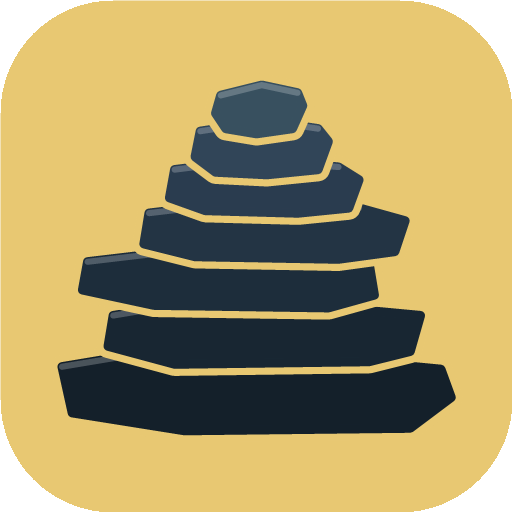

 

  
  <h3 align="center">Cairn Client</h3>
  
One launcher to play single-player games together.

## Table of Contents

- [About The Project](#about-the-project)
  - [Built With](#built-with)
- [Getting Started](#getting-started)
  - [Prerequisites](#prerequisites)
  - [Installation](#installation)
- [Credits](#credits)

## About The Project

**Cairn Client** turns single-player games into shared ones. One player hosts, a friend joins through Steam, and both of you
play in the same world. Each game is described by a small *game profile* (its executable, Steam app id, mod payload folder, menu
picture and server), so the launcher, the session handling and the setup checks are shared and a title is added as a profile
rather than as a new launcher.

Cairn Client is an **unofficial** project and a modified version of an earlier mod; it is not affiliated with any game's studio
or publisher. See AUTHORS.md for the complete list of contributors and historical upstream lineage.

### Built With

* 
* 
* 
* 
* 

## Getting Started

### Prerequisites

* Windows 10 or 11
* The **.NET 8 Desktop Runtime** and the **Microsoft Edge WebView2 Runtime** (the launcher's window is Blazor hosted in WebView2)
* The **Visual C++ runtimes** the game and the native plugin need (the launcher's setup checklist tells you if one is missing)
* Steam, with the game you want to play installed (see [Supported titles](#supported-titles))

### Installation

Download the latest installer (`.exe`) from the [Releases](https://github.com/Cairn-client/launcher/releases) page and run it.

The installer is not code-signed yet, so Windows may warn: click **More info**, then **Run anyway**.

The installer carries only the launcher. Each game's mod is a separate download: open the game in the launcher and click **Download mod**
(a small file from the same release, checked against a checksum before it is used). Games bought outside Steam can be pointed at
with **Locate game...** on their page. See [docs/PACKS.md](docs/PACKS.md).

## Credits

See [AUTHORS.md](AUTHORS.md) for the complete list of contributors and historical upstream lineage. Cairn Client is free software under the GNU General Public License version 3, see [LICENSE](LICENSE).

(<a href="#readme-top">back to top</a>)

